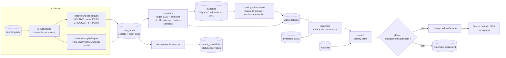

# CTI Vuln Watch — Architecture (proposition v1, à valider)

> Statut : **proposition**. Rien n'est implémenté au-delà du squelette de l'étape 0.

## 1. Principes structurants

| Principe | Traduction technique |
|---|---|
| Aucune affirmation sans source | Toute donnée métier (niveau de preuve, version corrigée, IoC...) est portée par une ligne `evidence` avec `url NOT NULL`. Ce qui n'a pas d'`evidence` n'existe pas pour le scoring. |
| Le LLM ne décide pas | Le LLM produit des *extractions* (JSON Pydantic). Chaque affirmation extraite doit citer un extrait **vérifié littéralement** dans le texte source, sinon elle est rejetée. Le niveau de preuve est calculé par `scoring/evidence.py`, en code pur. |
| Explorer large, alerter recoupé | Sources `observation` et signaux de niveau 4 : stockés et visibles, mais poids nul dans le calcul d'alerte. |
| Zéro code d'exploit | Les collecteurs PoC lisent uniquement des fichiers de **métadonnées** (`modules_metadata_base.json` de Metasploit, `cves.json` de nuclei, `files_exploits.csv` d'Exploit-DB, API GitHub pour les dépôts). Aucun `git clone`, aucun téléchargement d'archive ou de release. |
| Contenu collecté = donnée hostile | Assainissement, balisage, LLM sans outil, sortie strictement typée (§ 6). |
| Une panne ne bloque rien | Chaque exécution de collecteur est isolée (timeout, try/except, backoff). Après N échecs consécutifs, une alerte technique est émise. |

## 2. Conteneurs

```
┌──────────────────────── docker compose (projet "cti") ────────────────────────┐
│  db       pgvector/pgvector:pg16   volume pgdata, 127.0.0.1:5432, healthcheck │
│  backup   même image, uid 999      pg_dump quotidien -> ./backups, rétention   │
│  worker   image cti-agent, uid 10001  APScheduler : collecte/scoring/notif     │
│           entrypoint : alembic upgrade head (verrou advisory) puis scheduler   │
│  web      image cti-agent, uid 10001  FastAPI + Jinja2 (phase 3), :80->8000     │
│  cli      image cti-agent (profil "tools"), lancé par ./cti                    │
└──────────────────────────────────────────────────────────────────────────────┘
```
Une seule image applicative (`python:3.12-slim`, utilisateur non-root, système de fichiers en lecture seule sauf `/tmp`), `restart: unless-stopped` et healthcheck sur chaque service.

## 3. Arborescence

```
CTI/
├── start.sh stop.sh logs.sh reset.sh configure.sh cti   # commandes utilisateur
├── docker-compose.yml  .env.example  .gitignore
├── docker/  Dockerfile  entrypoint.sh  backup.sh
├── config/
│   ├── sources.yaml            # registre des sources (statut, fiabilité, fréquence)
│   ├── priority.yaml           # règles P1/P2/P3 (déclaratives)
│   ├── routing.yaml            # follow-the-sun : créneaux, canaux, langue
│   ├── product_aliases.yaml    # NetScaler = Citrix ADC = Citrix Gateway, CPE associés
│   ├── keywords.yaml           # mots-clés FR/EN : exploitation, contournement, PoC
│   └── inventory.example.yaml  # inventaire FICTIF (les inventaires réels sont ignorés par git)
├── src/cti/
│   ├── settings.py  logging.py  cli.py  scheduler.py
│   ├── db/            models.py  session.py  migrations/ (Alembic)
│   ├── registry/      chargement + validation de sources.yaml -> table sources
│   ├── collectors/
│   │   ├── base.py         # interface Collector -> list[RawItem]
│   │   ├── http.py         # client partagé : cache ETag/If-Modified-Since, backoff, robots.txt, User-Agent
│   │   ├── generic/        # rss, json_api (mapping de champs), html (sélecteurs CSS), github_repo,
│   │   │                   # mastodon, bluesky, reddit
│   │   └── specific/       # kev, nvd, cvelist, epss, ghsa, certfr, psirt_citrix, psirt_fortinet, psirt_ivanti
│   ├── extraction/    cve_ids.py (regex), sanitize.py, llm.py, schemas.py (Pydantic)
│   ├── enrichers/     fusion NVD/CNA/EPSS/KEV -> fiche vulnérabilité
│   ├── scoring/       evidence.py (niveau de preuve), confidence.py, poc_suspicion.py
│   ├── bypass/        révisions de bulletins (hash + diff), CVE liées, mots-clés    [phase 2]
│   ├── matching/      inventory.py, aliases.py, versions.py
│   ├── exposure/      shodan.py, censys.py (périmètre déclaré uniquement)          [phase 2]
│   ├── discovery/     domaines cités, précocité, détection de flux, fiabilité      [phase 2]
│   ├── notifiers/     teams.py (Adaptive Card), dryrun.py, email.py, jira.py, routing.py, dedup.py, templates/{fr,en}
│   └── web/           FastAPI + Jinja2                                               [phase 3]
├── tests/  fixtures/ (réponses réelles enregistrées)  unit/  integration/
└── docs/   ARCHITECTURE.md  DEMO.md
```

## 4. Flux de traitement



## 5. Modèle de données (PostgreSQL 16)

| Table | Rôle | Colonnes clés |
|---|---|---|
| `sources` | Miroir du registre YAML plus état d'exécution | `name` (unique), `type`, `url`, `config JSONB`, `tier` (1–4), `reliability` (0–1), `status` (active / observation / disabled), `interval_s`, `etag`, `last_modified`, `last_success_at`, `consecutive_failures`, `last_error` |
| `collector_runs` | Métriques et alertes techniques | `source_id`, `started_at`, `duration_ms`, `status`, `items_new`, `error` |
| `raw_items` | Tout contenu collecté, brut | `source_id`, `external_id`, `url`, `title`, `content`, `published_at`, `fetched_at`, `content_hash`, `raw JSONB`, `tsv tsvector` (GIN), `embedding vector(…)` [phase 2] ; UNIQUE(`source_id`, `external_id`) |
| `vulnerabilities` | Fiche consolidée par CVE | `cve_id` PK, `title`, `description_en`, `summary_fr`, `vendor`, `product`, `cpes JSONB`, `affected_versions JSONB`, `fixed_versions JSONB`, `patch_available`, `mitigations JSONB`, `cvss31_score/vector`, `cvss40_score/vector`, `epss`, `epss_percentile`, `kev`, `kev_added`, `evidence_level`, `confidence`, `has_conflict`, `conflict_notes`, `iocs JSONB`, `published_at`, `updated_at` |
| `evidence` | **Cœur de la traçabilité** : 1 affirmation = 1 ligne | `cve_id`, `source_id`, `raw_item_id`, `url NOT NULL`, `kind` (voir § 7), `assertion` (affirme / dément), `quote`, `observed_at`, `suspicious`, `suspicion_reasons JSONB`, `details JSONB` |
| `vuln_relations` | CVE liées (contournement, variante) | `cve_id`, `related_cve_id`, `relation` (references / variant_of / incomplete_fix_of), `evidence_id` |
| `advisory_snapshots` | Versions successives des bulletins éditeurs | `source_id`, `advisory_id`, `url`, `content_hash`, `normalized_text`, `affected JSONB`, `fixed JSONB`, `fetched_at` → diff entre deux snapshots |
| `watchlist` | Surveillance renforcée | `cve_id`, `reason`, `added_by`, `expires_at`, `created_at` |
| `clients`, `assets` | Miroir de l'inventaire YAML (le YAML fait foi) | `vendor`, `product`, `version`, `cpe`, `internet_exposed`, `origin` (declared / discovered_pending / discovered_validated) |
| `matches` | CVE × actif | `cve_id`, `asset_id`, `method` (cpe / alias), `version_status` (affected / not_affected / unknown) |
| `exposure_observations` | Résultats Shodan/Censys [phase 2] | `client_id`, `target`, `engine`, `product`, `version`, `observed_at`, `raw JSONB`, `review_status` |
| `alerts` | Historique des notifications et déduplication | `cve_id`, `priority`, `state_fingerprint`, `change_reasons`, `channel`, `audience`, `lang`, `status` (dry_run / sent / failed), `payload JSONB`, `sent_at` |
| `source_candidates`, `source_stats` | Découverte et fiabilité [phase 2] | domaine, flux détecté, nb de mentions, précocité, confirmations/démentis, bruit |

**Déduplication** : `state_fingerprint` = hash de (niveau de preuve, ensemble des clients concernés, hash de la dernière révision de bulletin, patch disponible, signal de contournement). Pas de renotification si l'empreinte est identique à celle de la dernière alerte envoyée pour cette CVE et cette audience.

## 6. LLM : périmètre et défenses contre la prompt injection

- **Usages** : `summary_fr` (≤ 3 phrases) et extraction structurée (produits, versions affectées ou corrigées, mitigations, IoC, *affirmations* d'exploitation, de PoC ou de contournement, **chacune avec une citation**).
- **Défenses** :
  1. Assainissement : HTML → texte, suppression des caractères invisibles (zero-width, bidi) et du contenu masqué, texte tronqué à N kB.
  2. Contenu placé entre balises `<untrusted_document>` ; le prompt système précise que ce contenu est une donnée et ne contient jamais d'instruction.
  3. Aucun outil ni accès réseau donné au modèle. Sortie JSON validée par Pydantic (champs et énumérations fermés), avec retry borné.
  4. **Vérification des citations** : toute affirmation dont la `quote` ne figure pas mot pour mot dans le texte source est rejetée. Les URL et IoC extraits doivent aussi apparaître dans la source.
  5. Le LLM ne reçoit jamais l'inventaire clients ni les secrets.
- **Sans clé** : pas de `summary_fr` (la description EN est affichée avec la mention « non traduit »), et l'extraction se limite aux parseurs déterministes.

## 7. Niveau de preuve (règles déterministes)

Seules les `evidence` provenant de sources au statut `active` comptent. Le niveau retenu est le plus élevé atteint :

| Niveau | Déclencheurs (`evidence.kind`) |
|---|---|
| `EXPLOITED_CONFIRMED` | `kev_listed` (CISA KEV) ; `vendor_exploited` (bulletin éditeur, niveau 1) ; `cert_exploited` (CERT-FR ou autre CERT, niveau 1) |
| `EXPLOITED_REPORTED` | `research_exploited` depuis une source de niveau 2–3 (watchTowr, Rapid7, Horizon3…) ; VulnCheck KEV |
| `POC_PUBLIC_VERIFIED` | `poc_metasploit`, `poc_nuclei`, `poc_exploitdb` |
| `POC_CLAIMED` | `poc_github` non suspect, `social_poc`, `search_poc` |
| `POC_SUSPICIOUS` | uniquement des `poc_github` marqués suspects (si un PoC fiable existe, le signal suspect reste affiché en drapeau) |
| `NO_KNOWN_EXPLOIT` | aucune des preuves ci-dessus |

- **Conflits** : `has_conflict = true` si, par exemple, l'éditeur *dément* l'exploitation (« not aware of exploitation ») alors qu'une source de niveau 2–3 l'*affirme*, ou si les versions corrigées diffèrent entre sources. Le conflit est affiché dans l'alerte sans être arbitré.
- **Signaux faibles** (niveau 4, recherche web) : plafonnés à `POC_CLAIMED` / `EXPLOITED_REPORTED`, et **jamais déclencheurs seuls** d'une P1 ou d'une P2.

**Score de confiance** (0–100) : `1 − Π(1 − wᵢ)` sur les sources *indépendantes* (un domaine compte une fois) qui soutiennent le niveau retenu, avec wᵢ = fiabilité de la source (défauts : niveau 1 = 0,6 ; niveau 2 = 0,4 ; niveau 3 = 0,25 ; niveau 4 = 0,1). Chaque démenti d'une source de niveau 1 applique une pénalité ×0,5. Le calcul est explicable : la fiche liste les contributions.

**Heuristique anti-faux-PoC** (métadonnées GitHub seulement) : compte créé il y a moins de 30 jours ; dépôt créé moins de 48 h après la publication de la CVE ; release ou fichiers binaires ou archives (`.exe`, `.dll`, `.zip`, `.rar`, `.7z`) dans l'arborescence de l'API ; description ou README générique ou incohérent (CVE absente, texte recopié) ; langages sans rapport avec la cible ; forks multiples d'un même motif. Au-delà d'un score de suspicion ≥ seuil, le dépôt est marqué `POC_SUSPICIOUS`. Les raisons sont stockées et affichées.

## 8. Priorité (`config/priority.yaml`, première règle satisfaite)

```yaml
- P1: exploited_any AND client_match
- P1: bypass_signal AND in_watchlist
- P1: cvss >= 9.0 AND client_asset_exposed          # exposé = déclaré ou détecté (Shodan/Censys)
- P2: (cvss >= 9.0 OR epss >= 0.5) AND client_match
- P2: poc_public_verified AND client_match
- P3: cvss >= 9.0 AND NOT client_match              # digest quotidien
- P3: new_source_candidate                          # digest quotidien
```
Un match dont la version est `unknown` compte comme concerné, avec la mention « version à confirmer ».

## 9. Sources MVP (phase 1) et points d'attention

| Source | Accès | Remarque |
|---|---|---|
| CISA KEV | JSON public | Collecte avec ETag |
| NVD API 2.0 | API (clé recommandée) | Retards d'enrichissement CPE connus côté NVD → repli sur les données du CNA via cvelistV5 |
| cvelistV5 | Releases GitHub « delta » (JSON horaire) | Pas de clone du dépôt (plusieurs Go) |
| EPSS | API FIRST | Par lots de 100 CVE |
| GitHub Advisories | GraphQL (token requis) | |
| CERT-FR | RSS avis + alertes | |
| PSIRT Citrix / Fortinet / Ivanti | RSS ou JSON si disponible, sinon HTML ciblé | **Flux officiels à confirmer en phase 1** ; les révisions de bulletins sont suivies par hash |

## 10. Limites identifiées à ce stade

- **Poste** : pas de droits admin, donc pas de Docker ni de WSL2 ; toutes les vérifications d'exécution sont en attente. Docker Desktop est **payant** pour les entreprises de plus de 250 salariés ; Rancher Desktop (gratuit) est compatible.
- **X/Twitter** exclu (API payante). Le social se limite à Mastodon, Bluesky et Reddit (API Reddit : authentification OAuth, quotas).
- **Shodan** : la recherche par `net:` ou `hostname:` exige un compte Membership payant. **Censys** : l'accès API gratuit est très restreint.
- **Recherche GitHub** : 30 requêtes/min avec un token. **NVD** : 50 requêtes/30 s avec clé.
- **Exploit-DB** : pas d'API officielle ; seul le CSV de métadonnées publié dans leur dépôt GitLab est utilisé.
- **Teams** : les connecteurs Office 365 historiques sont retirés ; seuls les webhooks Workflows sont supportés (Adaptive Cards).
